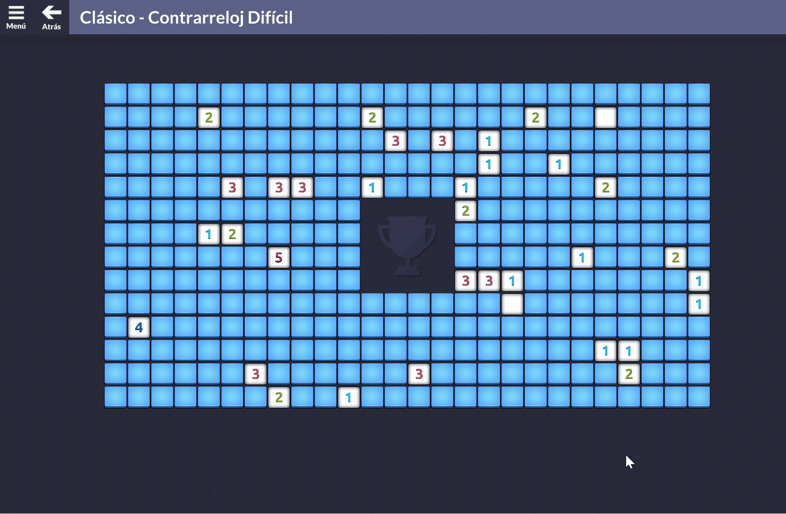
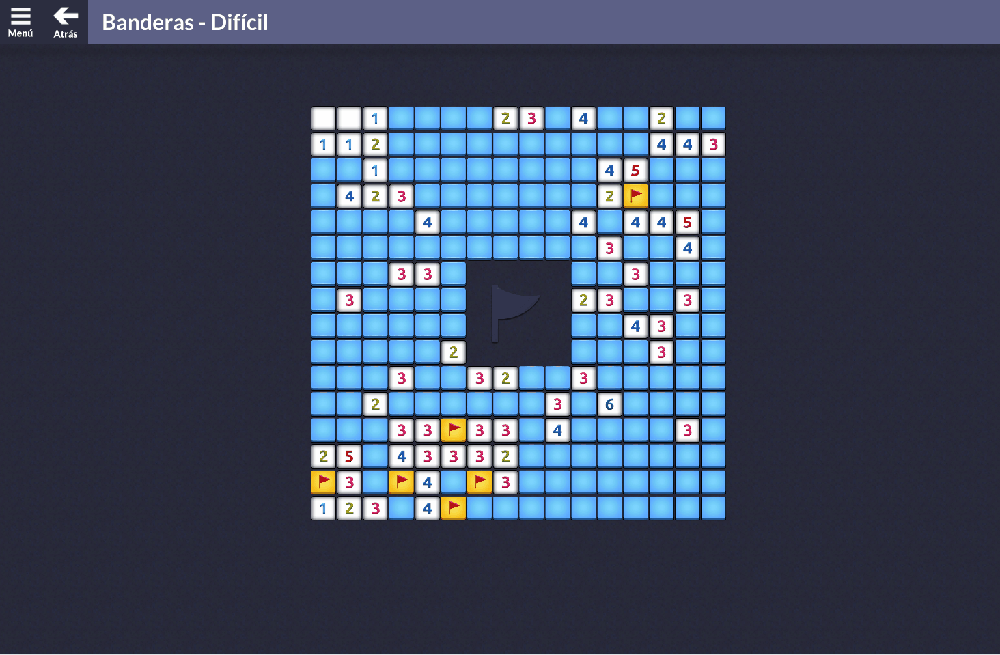
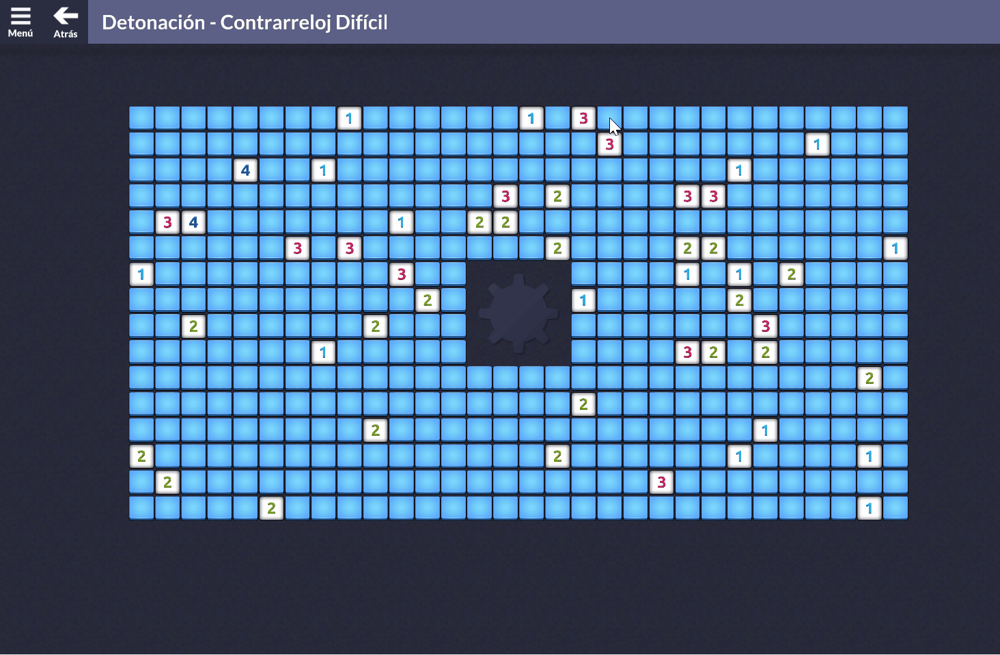
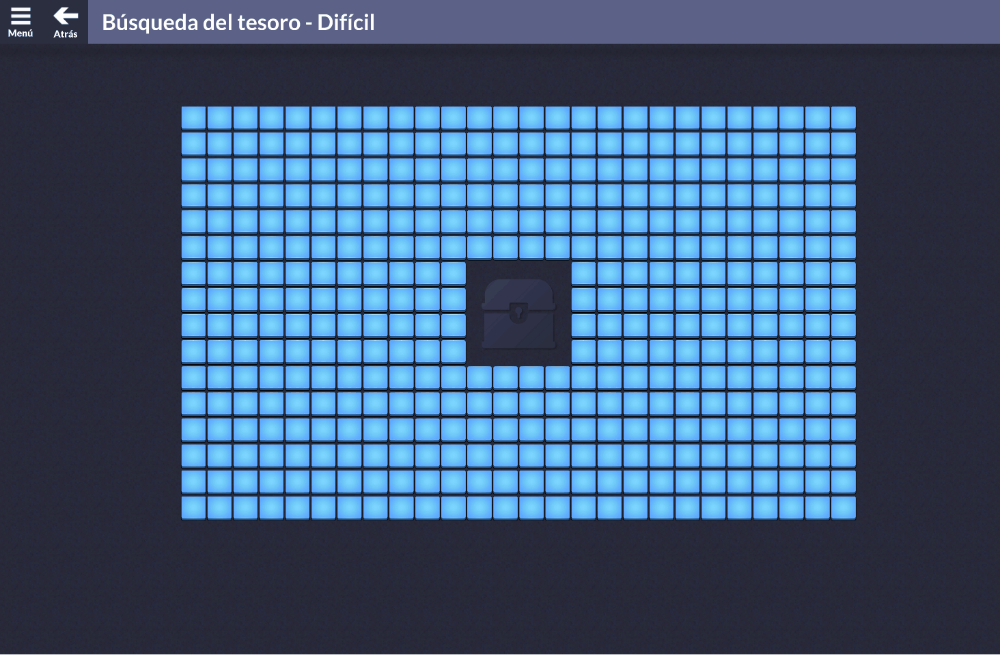
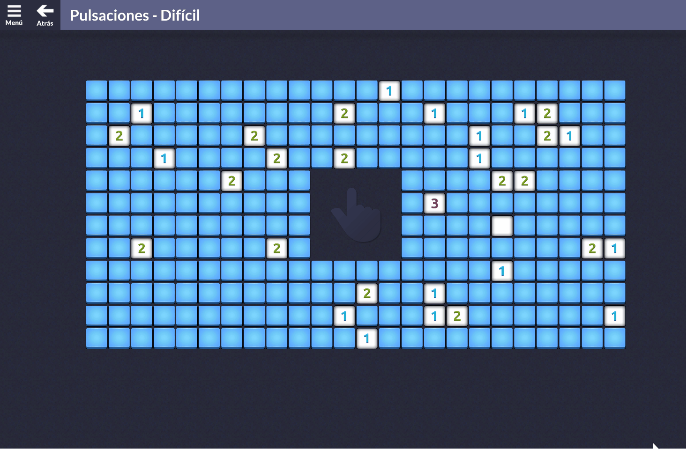

# Microsoft Minesweeper Solver

> *Read this in [Spanish](README_es.md)*

This started during a power cut. With no Wi-Fi, I ended up playing Microsoft Minesweeper and discovered the daily challenges. After a few games, I thought: why do all of these by hand when a bot could solve them?

So I built one in Python. It reads the screen, works out which cells to click and plays through the five challenge types. It can also go through the daily challenge menu on its own, completing a day and moving on to the next.

I used **AI as a programming assistant** while building it. The bot itself uses Minesweeper rules, constraint solving and probability calculations.

## Gameplay

These are recordings of the bot playing each mode. I left out the full daily run because it would make for a very long GIF.

### Classic

Opens safe cells and flags mines. When there is no certain move left, it chooses a low-risk guess.

<div align="center">

</div>

### Flags

Only places flags. It keeps deduced safe cells in memory, but never opens them.

<div align="center">

</div>

### Detonation

The goal is to click mines within the move budget. Revealing a mine can trigger a chain of safe openings, giving the solver more clues.

<div align="center">

</div>

### Treasure Hunt

Looks for the chest surrounded by mines. If safe openings run out, it considers mine rings and the remaining lives before choosing a guess.

<div align="center">

</div>

### Taps

Opens safe cells without placing flags. Cells opened by a cascade do not count as extra clicks toward the target.

<div align="center">

</div>

## How the solver works

The screen reader finds the grid with OpenCV, then classifies each cell. I started with colors, but that was not enough to distinguish all the numbers, so I added number templates and Tesseract OCR as a fallback. Unchanged cells are reused rather than read again every round.

The first layer of reasoning is the usual Minesweeper logic. If a number already has all its mines accounted for, the other neighbors are safe. If every unknown neighbor must be a mine, they all get marked. The solver also compares groups: if `{A, B}` contains one mine and `{A, B, C}` contains one mine, then `C` is safe.

For harder positions, it uses binary constraints to test whether a cell can possibly be safe or a mine. When it still needs to guess, it counts compatible mine arrangements, grouping equivalent cells and caching intermediate results to keep the calculation manageable.

If exact counting takes too long, it tries a short sampling pass over compatible arrangements. The samples are not uniform, so these estimates are only used to choose a guess. They never turn into confirmed flags or safe openings.

The practical part took plenty of work too: waiting for animations, recognizing the end of a game, skipping cells already opened by a cascade and checking whether the game actually registered a click. Known moves run in batches; new screenshots verify the result before the next batch.

## Installation

Requires **Windows**, **Python 3.10+**, Microsoft Minesweeper and **Tesseract OCR** installed separately. The bot checks the usual Windows location, `C:\Program Files\Tesseract-OCR\tesseract.exe`, as well as the executable search path.

From the repository directory:

```powershell
python -m venv .venv
.\.venv\Scripts\Activate.ps1
python -m pip install -r requirements.txt
```

Dependencies: OpenCV, NumPy, SciPy/HiGHS, pytesseract and PyAutoGUI.

## Run

### One Game

Open a game, run the command and bring Minesweeper to the foreground during the five-second countdown:

```powershell
python live.py --execute --loop --guess --click-delay 0.1 --output "..\live-game"
```

Omit `--guess` to stop when no certain permitted move is available. Omit `--execute` and `--loop` to inspect a plan without clicking.

### Daily Challenge Controller

Start on the **daily challenges panel**:

```powershell
python complete_challenges.py --execute --click-delay 0.1 --max-days 30 --output "..\daily-run"
```

Select September 1 manually to start a September run. `--max-days 30` limits the run to thirty processed day panels; it does not select dates. Already completed cards are skipped. After finishing a day, the bot advances with the right arrow and stops if the first card of the next day is already completed. Solver errors also stop the run.

Omit `--max-days` for no explicit day limit. Add `--no-guess` to disable guesses. Without `--execute`, the controller only inspects the panel.

Keep the game in the foreground and the window position unchanged. Move the mouse to a screen corner to trigger PyAutoGUI's fail-safe, or press `Ctrl+C` in the terminal to interrupt the process.

## Structure

| Files | Responsibility |
| --- | --- |
| `solver.py`, `certainty.py` | Deduction and certainty proofs |
| `probability.py`, `approximate_probability.py` | Exact counting and approximate guesses |
| `vision.py`, `ocr.py`, `*_templates.py` | Grid and cell recognition |
| `live.py`, `actions.py` | Game loop and mouse actions |
| `treasure.py`, `flags_mode.py`, `detonation.py` | Mode rules and counters |
| `daily.py`, `daily_vision.py`, `complete_challenges.py` | Daily navigation and entry point |
| `*_recovery.py`, `delayed_guess.py` | Action recovery and delayed verification |
| `tests/`, `assets/` | Tests, fixtures and recognition templates |

## Tests and a few practical notes

There are **203 tests** for the solver, screen reader, game modes and navigation. The interaction tests use simulated input, so running them will not move your mouse:

```powershell
python -m unittest discover -s tests -v
```

I tested it on all five modes and several board sizes, including 9×9, 16×16 and 30×16. Recognition depends on the game’s appearance, so a different theme or display scale may need adjustments.

It still loses guesses sometimes. The daily controller retries confirmed defeats and stops when it cannot trust a reading or verify an action. I use a `0.1` second click delay: setting it to zero was faster, but the game missed some clicks.

The [development notes](docs/development-notes.md) explain how the solver, screen reader and game controller evolved, and the decisions behind them.
